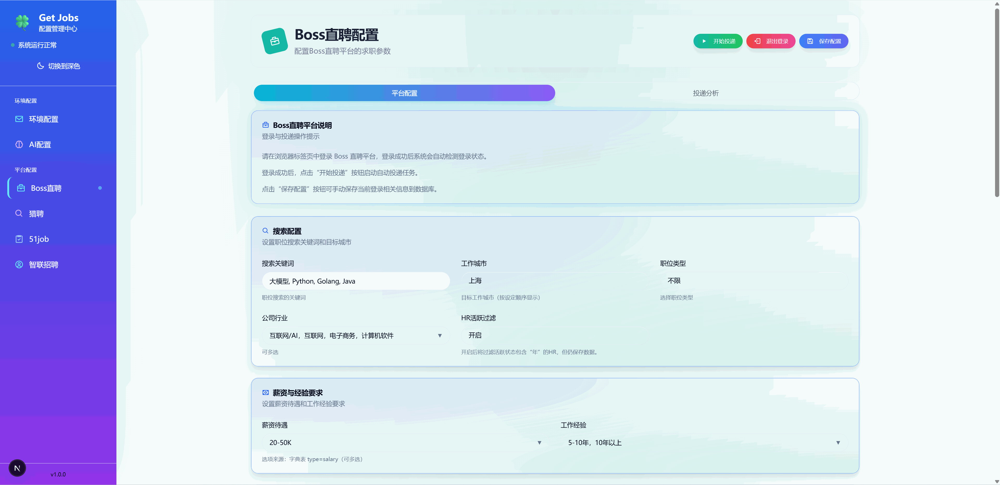
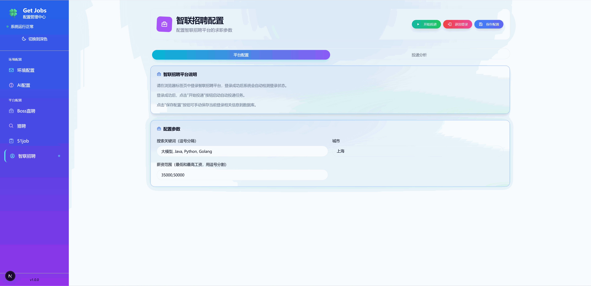
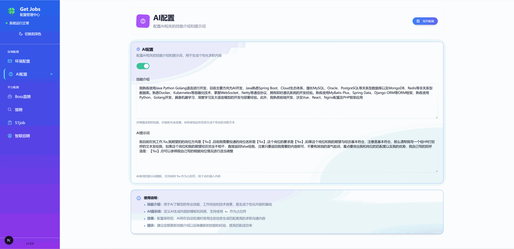
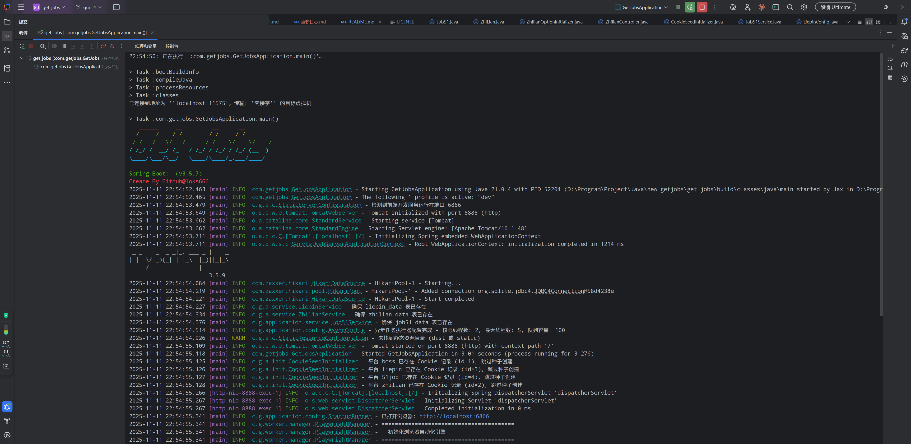

<div align="center">

# Get Jobs · 求职自动投递工具

**Boss直聘 / 智联招聘 / 前程无忧(51job) / 猎聘 —— 四平台自动投递**

[](LICENSE)


</div>

> **📌 仓库说明**
> 本项目是 [loks666/get_jobs](https://github.com/loks666/get_jobs) 的**个人二次开发分支**：修复了智联 / 51job / 猎聘的投递链路问题，新增四平台投递排队与状态管理、打招呼语三级回落等能力。原项目的版权、贡献者与致谢见文末，许可证为 **PolyForm Noncommercial 1.0.0（仅限非商业用途）**。

---

## ✨ 功能特性

### 四平台覆盖

| 平台 | 能力 |
|---|---|
| **Boss直聘** | AI 生成个性化打招呼语；打招呼语三级回落（AI → 自定义 → 账号默认）；投递后自动发送图片简历；不活跃 HR 过滤；黑名单自动维护 |
| **智联招聘** | 城市 / 关键词 / 薪资 / 职位类型（全职·兼职·实习）筛选；投递进度按关键词统计 |
| **前程无忧 51job** | 自动翻页投递；职位类型筛选；投递结果自动核对 |
| **猎聘** | 关键词 / 城市配置，自动打招呼 |

### 通用能力

- **🤖 AI 打招呼语**：兼容 OpenAI 接口格式（官方接口或自建中转均可），按 JD 自动撰写打招呼语
- **🚦 显性投递排队**：四平台共用同一个浏览器实例，自动排队执行；排队中的任务可随时取消
- **🛑 可靠的停止机制**：任务卡死时 15 秒内自动复位，界面不再永久卡在"停止中"
- **📊 实时状态**：后端状态机驱动（空闲 / 排队中 / 投递中 / 停止中），刷新页面不丢状态
- **🔐 持久登录**：登录态存本地 SQLite，大部分平台每周扫码一次即可
- **📢 企业微信推送**（可选）：投递结果通过机器人 Webhook 实时通知
- **🛡️ 反检测**：基于 Patchright（打过反检测补丁的 Playwright）驱动浏览器
- **🖥️ Web 管理页**：Next.js 单页应用，平台配置、登录、启停、进度一目了然

---

## 🧱 技术栈

| 层 | 技术 |
|---|---|
| 后端 | Java 21 · Spring Boot 3.5 · Playwright 1.62 + Patchright 1.62.1 · MyBatis-Plus · SQLite（WAL 模式） |
| 前端 | Next.js 16 · React 19 · TypeScript · Tailwind CSS |
| 构建 | Gradle 9.7（Kotlin DSL）· pnpm / corepack |

---

## 📦 环境要求

- **JDK 21**
- **Node.js 20+**（Playwright 驱动与前端构建依赖 npm/pnpm）
- 能正常访问目标招聘网站的网络（**请关闭墙外代理**，否则页面加载缓慢）
- 约 1 GB 磁盘空间（浏览器驱动与依赖）

---

## 🚀 快速开始

### 1️⃣ 获取数据库文件（新用户必做）

本项目**不自动创建全部数据表**，没有数据库文件无法启动。仓库不包含数据库，请从本仓库 release 页面下载空库模板：

1. 打开 [本仓库最新 release](https://github.com/wanghaomin25/get_jobs/releases/latest)
2. 下载附件 `getjobs.db.template`
3. 重命名为 `getjobs.db`，放到项目根目录的 `db/` 文件夹下，即 `db/getjobs.db`

模板已包含全部表结构（17 张）和各平台下拉框字典数据（城市 / 行业 / 经验 / 学历 / 职位类型等 **684 条**），配置、Cookie、投递记录均为空，由你在网页端自行填写。

> 老用户升级时若缺少新字段（如"职位类型"列），启动时会自动补齐，无需手工迁移。
> ⚠️ **切勿覆盖自己已有的 `db/getjobs.db`**，否则配置与登录态全部丢失。

### 2️⃣ 启动

Windows 推荐：

```bat
start.bat            :: 后台启动（jar 缺失时自动构建），可关闭窗口
start.bat console    :: 前台运行，控制台查看日志
stop.bat             :: 停止服务（按端口精确结束进程）
```

或手动构建运行：

```bash
gradlew bootJar                  # 构建（自动装配 Patchright 驱动 + 构建管理页）
java -jar build/libs/get_jobs.jar
```

首次构建会自动完成：安装 Patchright 反检测驱动 → 构建 Next.js 管理页。启动成功后自动打开管理页 **http://localhost:6866**（后端 API 端口 9527）。

### 3️⃣ 扫码登录

管理页 → 对应平台页面 → 扫码登录（Boss 支持 Cookie 持久化，登录一次可保持较长时间）。

### 4️⃣ 配置并开始投递

| 配置项 | 位置 | 说明 |
|---|---|---|
| AI 配置 | 管理页 → 环境配置 | `BASE_URL` / `API_KEY` / `MODEL`（OpenAI 兼容接口），保存后即生效，**无需修改 `.env`** |
| 企业微信推送（可选） | 管理页 → 环境配置 | `HOOK_URL` 填机器人 Webhook 地址 |
| Boss 配置 | 管理页 → Boss直聘 | 关键词、城市、打招呼语、图片简历开关、HR 活跃度过滤 |
| 智联 / 51job 配置 | 对应平台页面 | 关键词、城市、薪资、**职位类型**（全职 / 兼职 / 实习） |
| 图片简历 | Boss 配置页上传 | 上传 JPG 后随打招呼语自动发送（仅存本地，不进仓库、不进安装包） |

配置保存后，点击「**开始投递**」即可；投递过程中可随时「**停止投递**」（排队中也可取消），进度与状态实时显示。

---

## 💡 使用示例（Boss 直聘完整流程）

1. **登录**：管理页 → Boss直聘 → 扫码登录，确认状态显示"已登录"
2. **配置**：填写关键词（如 `Java后端`）与城市；开启 AI 打招呼或填写自定义招呼语；勾选"自动发送图片简历"并上传 JPG
3. **开始**：点击「开始投递」，页面显示"投递中"与实时进度
4. **观察**：AI 会为每个岗位生成个性化招呼语；命中不活跃 HR 的岗位自动过滤；已沟通过的 HR 不会重复打扰
5. **停止**：随时点击「停止投递」，任务安全收尾后回到"空闲"

<div align="center">
  
  
  <br/>
  
  
</div>

---

## 📁 目录结构

```
get_jobs/
├── src/main/java/com/getjobs/
│   ├── application/           Web 层：Controller / Service / Entity / Mapper
│   └── worker/                投递核心：boss · zhilian · job51 · liepin 四平台实现
├── src/main/resources/        配置、静态资源、管理页构建产物（dist/）
├── front/                     Next.js 管理页面源码
├── doc/ · docs/               项目文档与投递过程记录
├── build.gradle.kts           构建脚本（驱动装配 / 前端构建 / 打包任务）
├── start.bat · stop.bat       启动 / 停止脚本
└── db/                        SQLite 数据库（已被 .gitignore，不会提交）
```

---

## ❓ 常见问题

**Q: 启动报 `Port 9527 already in use`？**
A: 端口被占用。先运行 `stop.bat`；若无效，用 `netstat -ano | findstr :9527` 找到占用进程结束掉。注意不要在设置了 `SERVER_PORT` 环境变量的终端里启动。

**Q: clone 后管理页打不开 / 提示未找到管理页面？**
A: 管理页需要 Node.js 环境构建。确认已装 Node 20+，然后执行 `gradlew buildFrontend -PrebuildFrontend` 强制重建。

**Q: 提示 `database is locked`？**
A: 已启用 SQLite WAL 模式。请确认没有其它程序（如数据库工具）正打开 `db/getjobs.db`。

**Q: 我的简历会泄露吗？**
A: 不会。图片简历只保存在本地 `data/boss/resume/`，该目录已被 `.gitignore` 排除，构建时也会被明确排除，不会进入安装包。

**Q: 为什么投递结果和实际不一致？**
A: 51job 等平台的弹窗不返回真实成功数，程序按"勾选数"统计并做一致性校验，属平台限制。

---

## 📄 许可证

本项目采用 **PolyForm Noncommercial License 1.0.0**：任何人都可以免费使用、修改和分发本软件，但**仅限非商业用途**；商业使用需获得权利人的书面授权。

- **上游项目**：[loks666/get_jobs](https://github.com/loks666/get_jobs) —— 本项目的基础，感谢原作者及所有贡献者
- **本分支的主要修改**：智联 / 51job / 猎聘投递链路修复、四平台投递排队与状态管理、打招呼语三级回落、HR 活跃度过滤档位、Patchright 驱动装配与前端构建集成、独立 JAR 启动脚本
- 参与贡献请先阅读 [CLA.md](CLA.md)

---

<div align="center">

**如果这个项目对你有帮助，欢迎点个 ⭐ Star**

</div>
